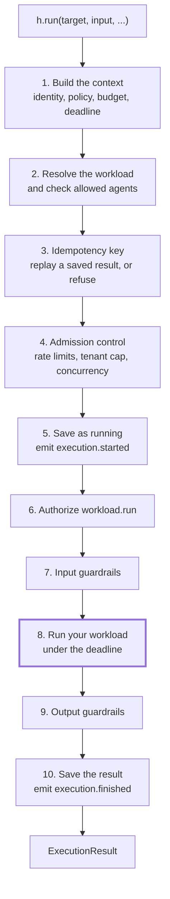

# How a run works

This page follows one call to `Harness.run` from start to finish, in the order things happen. Knowing the order tells you where a check lives, what has already happened by the time your code runs, and what a refusal at each step looks like.



A refusal at steps 2 to 7, or a failure at step 8 or 9, skips straight to step 10: the run is saved with the status and error that say why, and `run` returns it. Two exceptions: a problem building the context (step 1, such as a `tenant_id` that contradicts the identity) returns a failed result straight away without saving a record, and a replayed result (step 3) is returned as it was saved. Your workload (the thick box) is entered only if steps 1 to 7 all passed.

## The steps

1. **Build the context.** The harness creates an [`ExecutionContext`](execution-model.md) from your arguments. If you passed an `Identity`, `user_id` and `tenant_id` come from it, and a `user_id=` or `tenant_id=` that contradicts the identity fails the run. For a nested run (`parent=ctx`), the child inherits the parent's identity, shares its budget and may only narrow its policy.
2. **Resolve the workload.** An unknown name is a `routing` error. If the policy has an `allowed_agents` list, the target must be on it.
3. **Check the idempotency key.** If you passed `idempotency_key` and a run with that key already **completed**, you get its saved result back with `replayed=True` and nothing runs again. If a run with that key is still `running` (or was interrupted), the new call is refused: use [`resume`](state.md). Keys are scoped per tenant, so two tenants can use the same key.
4. **Admission control.** For a top-level run only: the per-tenant and per-user [rate limits](../guides/rate-limits.md), the per-tenant concurrency cap, and the global concurrency limit. A refusal ends the run as `budget_exhausted`. Draco rejects rather than queues, so one tenant cannot fill the queue.
5. **Persist and announce.** The record is saved as `running` and `execution.started` is emitted. **Critical** hooks run first and can veto the run by raising `PolicyViolation`.
6. **Authorize.** The harness's authorizer checks `workload.run` for this identity. With `require_identity`, no identity means denial here.
7. **Input guardrails.** Your guardrails see the input. Any exception blocks the run, not just `PolicyViolation` (fail closed).
8. **Run your workload.** It executes as a task under the deadline and cancellation token. Inside it, the tool runtime, model calls and nested runs each charge the same budget.
9. **Output guardrails.** They see what the workload returned.
10. **Finish.** The harness works out usage, saves the final record, emits `execution.finished` (or `failed`, `cancelled`, `timeout`, `budget_exhausted`), and returns the result.

Whatever goes wrong, the outcome is a normal `ExecutionResult` with a non-`completed` status and an `error` that says why.

## Guardrails

A guardrail is a plain function of `(ctx, payload)`. It raises `PolicyViolation` to block. Draco includes `max_input_chars`:

<!-- doctest -->
```python
import asyncio
from draco import Harness
from draco.policies.guardrails import max_input_chars

async def echo(ctx, text):
    return text

async def main():
    h = Harness()
    h.add_input_guardrail(max_input_chars(5))
    h.register("echo", echo)
    print((await h.run("echo", "short")).status)
    r = await h.run("echo", "far too long")
    print(r.status, r.error.code, r.error.message)

asyncio.run(main())
```

<!-- output -->
```text
completed
failed policy input exceeds 5 characters
```

If a guardrail itself crashes, the run is blocked, because a broken safety check must not turn into an open door.

## Hooks

`h.on(pattern, handler, critical=False)` subscribes to events such as `execution.started`, `tool.before` and `step.completed` (see [events](../reference/events.md)).

- A normal handler is for observing: metrics, audit export. If it raises, the error is recorded and the run continues. **Telemetry can never break a run.**
- A `critical=True` handler is for enforcing: quotas, tenant blocks, approvals. It runs before normal handlers, and if it raises `PolicyViolation` on `execution.started` or `tool.before`, the run or the tool call is stopped.

## What `run` never does

- It never raises for a failure *inside* your workload. The one exception: if the **caller's own task** is cancelled, Draco records the cancellation and then lets `CancelledError` propagate, as asyncio expects.
- It never reports a failure as success. Check `result.ok` or `result.status`.

## Next

[Context, results and errors](execution-model.md) describes the objects this page mentioned.
